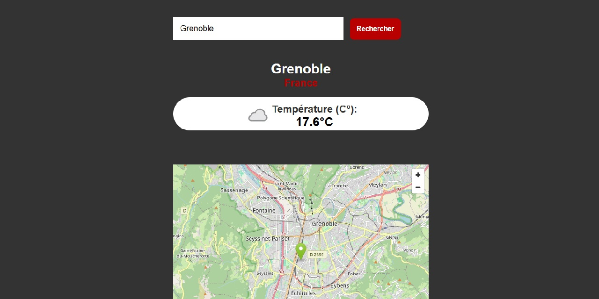

  

## Objectif du projet

Cette application permet de rechercher la météo actuelle d’une ville. Elle récupère les données depuis une API météo et affiche la température, les conditions météorologiques et la localisation sur une carte.

### Réalisations techniques

- Envoyer une requête asynchrone avec `fetch` vers une API REST et traiter sa réponse.
- Afficher les informations météo reçues, ainsi qu’une carte Google Maps centrée sur la ville recherchée.
- Gérer les différents états de l'application : chargement, traitement des erreurs HTTP et validation des saisies utilisateur.
